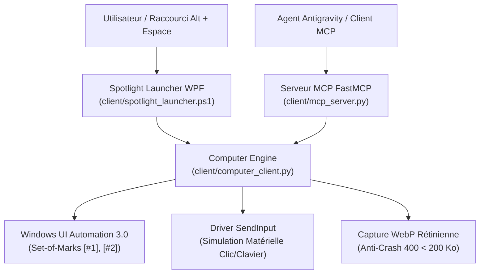

# Antigravity Computer Use & Spotlight Companion 🖥️⚡

[](https://microsoft.com/windows)
[](https://python.org)
[](https://modelcontextprotocol.io/)
[](https://learn.microsoft.com/windows/win32/winauto/entry-uiauto-win32)
[](LICENSE)
[](https://julienpiron.fr)

> **SOTA Window-Scoped Windows OS Automation Engine & Global Desktop Spotlight Companion (`Alt + Space`) with « Work with Apps » context detection for Google Antigravity and AI agents.**

Conçu pour égaler et surpasser les capacités Desktop de Claude Computer Use et ChatGPT Windows, ce projet offre une automatisation déterministe et isolée de n'importe quel logiciel Windows (VS Code, Chrome, Terminal, Office, applications métier) couplée à un compagnon de bureau flottant accessible depuis n'importe où.

---

## 🌟 Pourquoi cette architecture surpasse Claude Computer Use

| Défi | Claude Computer Use Standard | Antigravity Computer Use (Ce Projet) |
| :--- | :--- | :--- |
| **Périmètre d'action** | Devinage de coordonnées sur l'écran complet (vulnérable aux fenêtres de fond) | **Isolation stricte par fenêtre (*Window-Scoped*)** |
| **Précision du ciblage** | Approximation par vision seule | **Arbre déterministe UI Automation 3.0 + Set-of-Marks `[#1]`, `[#2]`** |
| **Clavier & Layout** | Souvent limité au QWERTY US | **Saisie matérielle `SendInput` Unicode universelle (AZERTY, accents, symboles)** |
| **Taille des captures** | Dumps PNG bruts lourds (> 1 Mo, risque d'erreur HTTP 400) | **Captures rétiniennes WebP garanties < 200 Ko (Règle Anti-Crash 400)** |
| **Accessibilité utilisateur** | Console ou IDE distant uniquement | **Barre flottante globale `Alt + Espace` + Icône en barre des tâches** |

---

## ✨ Fonctionnalités Principales

1. **🚀 Compagnon Bureau Flottant Spotlight (`Alt + Espace`)** :
   - Accessible partout sous Windows via `Alt + Espace` (ou `Alt + Shift + Espace`).
   - Carte flottante WPF translucide, coins arrondis natifs DWM Windows 11, thème sombre Google Gemini `#131314`.
   - **Détection automatique de l'application active (*« Work with Apps »*)** : attache en un instant le contexte du logiciel sous vos yeux (`[ ⓘ code : main.py ✕ ]`).
   - Pilules d'actions rapides : Capture WebP, Ouverture du panneau Chrome, Audit SoM, Réduction dans la barre des tâches.

2. **🎯 Moteur Déterministe UI Automation 3.0** :
   - Indexation automatique de tous les contrôles cliquables, champs de texte et listes avec des marqueurs `[#1]`, `[#2]` et coordonnées spatiales Gemini `box_2d` [0-1000].
   - Clics et saisies par numéro d'index (`computer_click(element_index=1)`).

3. **📸 Captures Rétiniennes WebP Anti-Crash 400** :
   - Compression WebP haute fidélité calibrée pour rester systématiquement sous les 200 Ko, éliminant les erreurs `HTTP 400 Bad Request: INVALID_ARGUMENT` des API d'IA multimodales.

4. **🔌 Serveur MCP Natif (Model Context Protocol)** :
   - Exposition de 12 outils prêts à l'emploi pour Antigravity, Claude Desktop ou tout client MCP.

---

## 🏛️ Architecture



---

## 🛠️ Outils MCP Disponibles

| Outil MCP | Description |
| :--- | :--- |
| `computer_list_windows` | Découvre les fenêtres ouvertes et identifie la fenêtre au premier plan |
| `computer_list_apps` | Regroupe les fenêtres par exécutable (`code`, `chrome`, `terminal`...) |
| `computer_focus_window` | Active, restaure et place au premier plan sans désordonner la géométrie |
| `computer_get_window_state` | Extrait l'arbre UI Automation avec Set-of-Marks `[#1..#N]` |
| `computer_click` | Clic déterministe par index d'élément ou coordonnées relatives |
| `computer_type_text` | Saisie de texte Unicode universelle avec support complet des accents |
| `computer_press_key` | Simulation de raccourcis (`Win+R`, `Ctrl+Shift+P`, `Alt+Tab`...) |
| `computer_scroll` | Défilement fluide de molette souris (vertical et horizontal) |
| `computer_drag` | Glisser-déposer fluide multi-étapes |
| `computer_take_screenshot` | Capture WebP haute définition garantie < 200 Ko |
| `computer_spotlight_status` | Vérifie l'état du compagnon bureau flottant |
| `computer_spotlight_toggle` | Démarre ou masque le compagnon de bureau en arrière-plan |

---

## 🚀 Installation & Démarrage

### 1. Cloner le Dépôt
```bash
git clone https://github.com/pironjulien/antigravity-computer-use.git
cd antigravity-computer-use
```

### 2. Installer les Dépendances Python
```bash
pip install -e .
```

### 3. Lancer le Compagnon Bureau Spotlight
```powershell
pwsh -NoProfile -File client/spotlight_launcher.ps1
```
*Appuyez sur `Alt + Espace` pour afficher ou masquer la barre à tout moment.*

### 4. Lancer le Serveur MCP
```bash
python client/mcp_server.py --server computer
```

### 5. Lancer les Tests Unitaires
```bash
pytest tests/ -v
```

---

## 👨‍💻 Auteur & Licence

Développé par **Julien Piron** ([julienpiron.fr](https://julienpiron.fr) | X : [@julienpironfr](https://x.com/julienpironfr)).  
Publié sous licence **MIT**. Voir le fichier [LICENSE](LICENSE) pour plus de détails.
