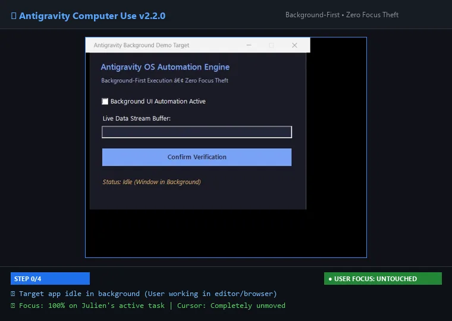

# Antigravity Computer Use — SOTA Windows OS Automation & Spotlight Companion 🖥️⚡

[](https://microsoft.com/windows)
[](https://python.org)
[](https://modelcontextprotocol.io/)
[](https://github.com/pironjulien/antigravity-computer-use)
[](https://learn.microsoft.com/windows/win32/winauto/entry-uiauto-win32)
[](https://github.com/pironjulien/antigravity-computer-use)
[](LICENSE)
[](https://julienpiron.fr)

> **Autonomous Windows Computer Use engine and global Spotlight desktop companion (`Alt + Space`) engineered exclusively for Google Antigravity and Gemini multimodal models.**
>
> 🚀 **Drive Windows desktop applications in the background with zero focus stealing, zero unwanted cursor movement, strict Z-order preservation, and ultra-fast focus restoration (10–50 ms WinEventHook).**

---

## 🎬 Demonstration: 100% Background Execution



*Target applications are automated silently in the background via UI Automation 3.0 patterns (`TogglePattern`, `ValuePattern`, `InvokePattern`, `WindowPattern`) and offscreen GDI buffers, while the user's physical focus and mouse remain completely undisturbed in the foreground.*

---

## ⚡ How Antigravity Computer Use Transforms OS Automation

Conventional OS automation frameworks rely on full-screen screenshots, coarse pixel coordinate guessing by vision models, physical mouse cursor movement, and forced window focus. This disrupts user workflows and prevents concurrent agent operation.

`antigravity-computer-use` adopts a **deterministic, background-first paradigm**:

| Feature | Conventional Automation | **Antigravity Computer Use (`nexus-computer`)** |
| :--- | :--- | :--- |
| **Background Execution** | ❌ Window must be visible in foreground | ✅ **100% Native Background** (no focus theft) |
| **Focus Hijacking** | ⚠️ Steals keyboard focus and foreground window | ⚡ **Zero Focus Theft** (10–50 ms `WinEventHook` with auto-restoration) |
| **Cursor Takeover** | ⚠️ Physical mouse moved across screen | 🟢 **Zero Cursor Movement** (Deterministic COM UI Automation invocation) |
| **Control Targeting** | 👁️ Coarse pixel coordinate estimation | 🎯 **COM UI Automation 3.0 + Set-of-Marks `[#1..#N]` + Gemini `box_2d` `[ymin, xmin, ymax, xmax]`** |
| **Clean Window Closing** | ❌ Force-killing processes (`taskkill`) | 🛡️ **Deterministic `computer_close_window`** (`WindowPattern.Close()` then graceful `WM_CLOSE`) |
| **Occluded / Covered Windows** | ❌ Fails if window is obscured | 📸 **Offscreen GDI Buffer** (`PrintWindow` `PW_RENDERFULLCONTENT`) |
| **Image Protocol Safety** | ⚠️ Heavy PNGs (> 1 MB) triggering Cloud API 400 | 🛡️ **WebP Compressed < 200 KB** (Guaranteed Anti-Crash 400 guard) |
| **Keyboard & Character Sets** | ❌ Fragile on non-US layouts | 🌍 **Universal Unicode SendInput + UTF-16 surrogates (AZERTY, accents, emojis)** |
| **Desktop Companion** | ❌ None | ⚡ **Global Floating Spotlight (`Alt + Space`)** with *Work with Apps* detection |

---

## 🏛️ Deterministic Architecture

```mermaid
flowchart TD
    AGY["Google Antigravity\n(CLI agy / Antigravity IDE)"] -->|Model Context Protocol (FastMCP)| MCPServer["Antigravity MCP Server\n(client/mcp_server.py)"]
    
    subgraph EngineCore ["Windows Core Engine (client/computer_client.py)"]
        Router{"Execution Strategy"}
        
        Router -->|Click / Toggle / Select| UIA_Action["COM UI Automation 3.0 Patterns\n(TogglePattern / ValuePattern / InvokePattern / WindowPattern)"]
        Router -->|State Inspection & Grounding| UIA_Tree["Recursive UIA Tree Traversal\n(Set-of-Marks [#1..#N] & Gemini box_2d)"]
        Router -->|Safe Screen Capture| GDI["Win32 Offscreen GDI Buffer\nPrintWindow(PW_RENDERFULLCONTENT)"]
        Router -->|Hardware Action Required| FocusGuard["ForegroundGuard (10-50ms WinEventHook)\n+ Immediate Z-Order Restoration"]
    end
    
    MCPServer --> EngineCore
    
    UIA_Action -->|Direct COM Dispatch| TargetApp["Target Windows Application\n(VS Code, Chrome, Terminal, Office, Win32/WPF/WinUI)"]
    GDI -->|Direct Memory Copy| TargetApp
    
    style EngineCore fill:#161b22,stroke:#4285f4,stroke-width:2px
    style TargetApp fill:#0d1117,stroke:#34a853,stroke-width:2px
```

---

## 🔌 Native Integration with Google Antigravity

The `antigravity-computer-use` MCP server integrates natively into Google Antigravity via your `mcp_config.json`:

```json
{
  "mcpServers": {
    "nexus-computer": {
      "command": "python",
      "args": [
        "C:/Dev/antigravity-computer-use/client/mcp_server.py",
        "--scope",
        "computer"
      ]
    }
  }
}
```

---

## 🛠️ MCP Tools Directory

| MCP Tool | Background Safe | Description |
| :--- | :---: | :--- |
| `computer_list_windows` | ✅ Yes | Enumerates interactive windows with HWNDs, titles, geometries, and foreground status. |
| `computer_list_apps` | ✅ Yes | Groups active windows by executable process (`chrome`, `code`, `pwsh`...). |
| `computer_get_window_state` | ✅ Yes | Extracts UI Automation tree with Set-of-Marks `[#1..#N]` and Gemini `box_2d` coordinates `[ymin, xmin, ymax, xmax]`. |
| `computer_focus_window` | ⚠️ Focus Guard | Gracefully activates target window without disrupting desktop layout. |
| `computer_close_window` | ✅ Yes | Deterministically closes windows via UIA `WindowPattern.Close()` with graceful `WM_CLOSE` fallback. |
| `computer_click` | ✅ Yes | Deterministic background click via UIA (`Invoke`, `Toggle`, `Select`) with zero physical cursor movement. |
| `computer_type_text` | ✅ Yes | Direct background text input via `ValuePattern`, with graceful Unicode typing fallback. |
| `computer_press_key` | ⚠️ Focus Guard | Injects keyboard shortcuts (`Ctrl+Shift+P`, `Win+R`) with ForegroundGuard protection. |
| `computer_scroll` | ✅ Yes | Scrolls UIA container vertically or horizontally without physical mouse wheel events. |
| `computer_mouse_move` | ⚠️ Focus Guard | Smooth Bézier mouse movement trajectory when physical hardware interaction is explicitly required. |
| `computer_drag` | ⚠️ Focus Guard | Multi-step drag and drop between two coordinate points. |
| `computer_take_screenshot` | ✅ Yes | Offscreen screenshot without focus theft, compressed to WebP < 200 KB (Anti-Crash 400). |
| `computer_spotlight_status` | ✅ Yes | Checks if the global floating HUD (`Alt + Space`) is active. |
| `computer_spotlight_toggle` | ✅ Yes | Shows or hides the floating desktop companion. |

---

## 🚀 Quickstart & Testing

### 1. Clone the Repository
```bash
git clone https://github.com/pironjulien/antigravity-computer-use.git
cd antigravity-computer-use
```

### 2. Run Deterministic Test Suite (26 Unit Tests)
```bash
pytest tests/test_computer.py tests/test_spotlight.py -v
```

### 3. Launch the Spotlight Companion (`Alt + Space`)
```powershell
pwsh -NoProfile -File client/spotlight_launcher.ps1
```
*Press `Alt + Space` anywhere in Windows to summon the Antigravity HUD.*

---

## 👨‍💻 Author & License

Engineered in symbiosis by **Julien Piron** ([julienpiron.fr](https://julienpiron.fr) • [julienpiron.com](https://julienpiron.com) • X: [@julienpironfr](https://x.com/julienpironfr)).

Released under the **MIT License**. See [LICENSE](LICENSE) for details.
